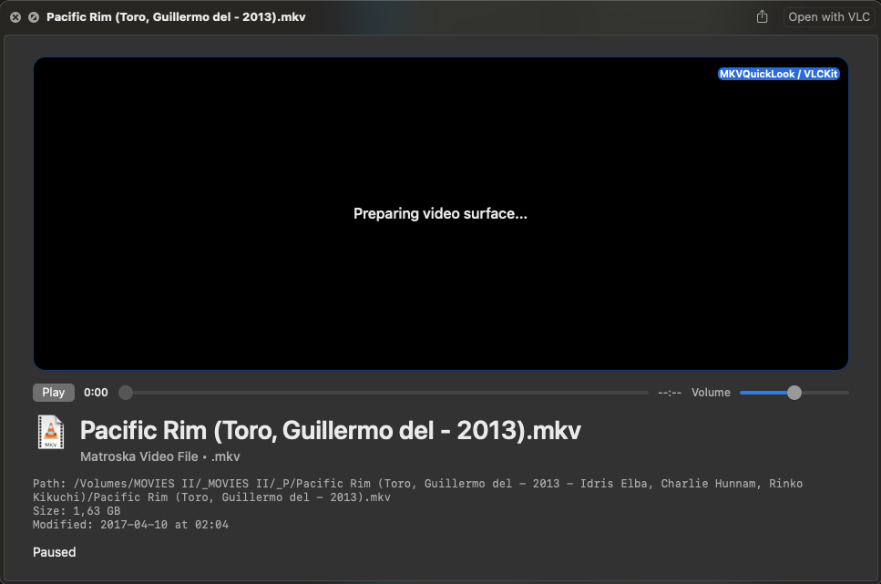

# MKVQuickLook

Version: `0.1.13` (`build 14`)

macOS host app plus Quick Look Preview Extension scaffold for:

- `mkv`
- `webm`
- `ogg` / `ogv`
- `opus` (audio-only)

`MKVQuickLook` provides a Finder Quick Look preview for these formats on macOS by shipping a small host app with a bundled Quick Look Preview Extension and embedded `VLCKit` playback backend.



## Gatekeeper

This app is currently distributed as an ad hoc signed DMG build and is **not notarized**.

- macOS Gatekeeper may warn when users open it for the first time.
- That is expected for the current release process.
- Users may need to open it via Finder context menu or allow it in System Settings after the first launch attempt.

## License

MKVQuickLook's own source code is licensed under the MIT License (`LICENSE`).

The app bundles `VLCKit` 3.7.2 (VLC 3.0.23), licensed under the GNU LGPL 2.1 or later. [`THIRD_PARTY_NOTICES.md`](THIRD_PARTY_NOTICES.md) lists the exact versions, the links to the corresponding source code, and how to replace `VLCKit` with a modified build. The app ships `LICENSE`, `VLCKit-COPYING.txt` and `THIRD_PARTY_NOTICES.md` in `Contents/Resources` and shows them under Settings → License. Every GitHub release repeats the notices in its release notes.

## Current Status

- host app with main window, settings/help UI, and playback lab
- Quick Look Preview Extension registered for owned target file types
- `VLCKit 3.7.2` fetched into `Vendor/` by a bootstrap script
- direct VLCKit-backed playback path for supported files
- audio-only files (`.opus`, and Ogg files without a video track) use the same VLCKit backend with an audio preview UI; audio vs. video is decided from the tracks in the file
- Finder registration and Launch Services ownership wired into the app bundle metadata
- full Quick Look preview autoplays; compact Finder preview remains summary-only
- renderer, metadata, and UI regressions covered by automated tests
- hover overlay play/pause on the video frame (like native Quick Look); VoiceOver, Voice Control and Full Keyboard Access can use it as a button
- every new preview starts at 35% volume
- the VLC engine uses its own read-only settings file; it never reads or changes the settings of the VLC app
- seek and volume sliders jump immediately to click position

## Known Limitations

- **AVI is not supported.** While another app, such as VLC, is the default app for `.avi`, Quick Look uses Apple's own previewer. On macOS 26 that previewer cannot play AVI files with DivX (MPEG-4 Part 2) video and MP3 audio.
- **Routing depends on each Mac.** Quick Look picks a previewer by the type identifier macOS resolves for a file. Other installed apps can declare their own identifiers for `.ogg`, `.opus` or `.ogv`. This release covers the identifiers known so far (`org.xiph.ogg-audio`, `org.xiph.ogg-video`, and others). If a supported file still shows Apple's generic preview, please report the output of `mdls -name kMDItemContentType <file>`.
- **Sound can continue after switching files.** When Finder switches from an MKVQuickLook preview to a file that another previewer shows (`.mp4`, `.mov`, `.avi`), Finder does not tell the extension. In column view, or with the preview pane open, the old preview stops anyway. In Gallery view, and in list or icon view without the preview pane, it keeps playing until Finder closes it.
- **Rare freeze: cause removed in 0.1.12, not yet proven in long use.** Up to 0.1.11, VLCKit could rarely freeze the extension while it saved VLC's settings. Since 0.1.12 the VLC engine uses its own read-only settings file, so VLC no longer saves. If Quick Look still stops showing these files, open Activity Monitor, quit the process `MKVQuickLookPreviewExtension`, and please report it. macOS starts a new one for the next preview.
- **Rare crash: fixed in 0.1.13, not yet proven in long use.** Up to 0.1.12, VLCKit could crash the extension when a preview closed right after a stop and a new start (seen twice). The cause is found and reproduced, and the fix is tested. If it still happens, macOS starts a new extension process for the next preview; please report it.
- **Not notarized.** See "Gatekeeper" above.

## Playback Delays

There is a short but perceptible delay for both seek and volume changes. These are **not software bugs**. They are inherent to how digital audio and compressed video work.

### Volume delay

When you move the volume slider, the API call sets the new level instantly. The delay you hear is the **audio output pipeline latency**.

VLCKit renders decoded audio into a ring buffer. That buffer feeds Core Audio, which feeds the hardware DAC. The buffer exists to absorb CPU timing jitter — without it, even a brief stall would cause audible crackling, pops, or dropout. On macOS the buffer depth is typically **80–200 ms**. Volume changes apply only to audio that has not yet entered the buffer. The audio already queued plays at the old level and drains through first. You cannot eliminate this without destroying the buffer, which causes immediate playback glitches. Even macOS's own system volume control has a milder version of this effect for the same reason.

### Seek delay

Video frames use inter-frame compression. P-frames and B-frames reference earlier frames and cannot be decoded by themselves. Only keyframes (I-frames) are self-contained. Seeking to any arbitrary position requires:

1. Find the nearest keyframe before the target position in the file
2. Decode every frame from that keyframe forward to the target frame

A typical H.264 or HEVC stream has a keyframe every 2–10 seconds. At 30 fps that can mean decoding up to **150–300 frames** before the target frame can be displayed. For HD content this takes **100–500 ms** even with hardware-assisted decoding. Native Apple players appear faster because AVFoundation has direct access to the Apple Silicon hardware video decoder with tighter integration; VLCKit's pipeline operates at a higher abstraction level.

The UI remains responsive during seeks — the slider position updates immediately. The video frame catches up as the decoder finishes.

## Bundling

`VLCKit` is bundled automatically as part of this app.

- It does not need to be pre-installed on the Mac.
- The app does not download it at runtime.
- The framework is downloaded for development by `./scripts/bootstrap-vlckit.sh` into `Vendor/VLCKit.xcframework`.
- During the build, Xcode embeds `VLCKit.framework` **once**, at `MKVQuickLook.app/Contents/Frameworks/`.
- The Quick Look extension loads that copy. `VLCKit` records its load path as `@loader_path/../Frameworks/...` (next to the loading binary), so a build step of the extension target (`scripts/link-extension-to-app-vlckit.sh`) rewrites the extension's reference to `@loader_path/../../../../Frameworks/...` after linking.
- `scripts/verify-vlckit-load-paths.sh` checks a built app (one copy, every reference resolves). The install and release scripts run it before they install or package anything.

This means the shipped app is self-contained with respect to the playback backend.

`VLCKit` is licensed under the LGPL 2.1. The build copies its license text into the app at `MKVQuickLook.app/Contents/Resources/VLCKit-COPYING.txt`.

## Requirements

- macOS 14 or later
- Xcode 16.2 or later recommended
- `xcodegen` if you want to regenerate the project from `project.yml`

## Project Files

- `project.yml`: XcodeGen spec
- `MKVQuickLook.xcodeproj`: generated Xcode project
- `CHANGELOG.md`: versioned change history
- `LICENSE`: MIT license of MKVQuickLook's own code
- `THIRD_PARTY_NOTICES.md`: VLCKit license, exact source code, replacement instructions
- `scripts/bootstrap-vlckit.sh`: downloads the pinned official VideoLAN binary package
- `Vendor/`: local dependency install location created by the bootstrap script

Repository policy:

- release artifacts in `dist/` are local build outputs and must not be committed
- large local sample media belongs in `example-videos/` and must not be committed
- `VLCKit` is fetched on demand rather than committed into Git history
- vendored debug symbols are intentionally not kept because they add hundreds of megabytes and are not required to build or run the app

## Build

Fetch the pinned `VLCKit` package first:

```sh
./scripts/bootstrap-vlckit.sh
```

If you just cloned the repo and `Vendor/` looks empty or incomplete, that is expected. The binary dependency is no longer committed to Git history and must be populated locally by the bootstrap script.

Generate the project if needed:

```sh
xcodegen generate
```

Build from the command line without signing:

```sh
xcodebuild \
  -project MKVQuickLook.xcodeproj \
  -scheme MKVQuickLook \
  -configuration Debug \
  -destination 'platform=macOS' \
  CODE_SIGNING_ALLOWED=NO \
  build
```

## Install Locally

Build, copy to `~/Applications`, refresh Quick Look, and open the app once:

```sh
./scripts/install-local.sh
```

That script also applies ad hoc bundle signatures to the framework, extension, and app bundle, because plain `CODE_SIGNING_ALLOWED=NO` debug builds are not enough for reliable Quick Look extension registration.

`install-local.sh` automatically bootstraps `VLCKit` first if it is missing.

Refresh Quick Look manually without reinstalling:

```sh
./scripts/reset-quicklook.sh
```

## Build A Release DMG

Create a release-style DMG in `dist/`:

```sh
./scripts/build-release-dmg.sh
```

What this script does:

- bootstraps `VLCKit` if needed
- builds the app in `Release`
- applies ad hoc signatures to the framework, extension, and app bundle
- stages the app with an `Applications` symlink
- creates `dist/MKVQuickLook-v<version>.dmg`

This is suitable for GitHub Releases. It is not notarized.

`dist/` is ignored by Git. Build the DMG locally, then upload it to a GitHub Release instead of committing it into the repository history.

## Publish A GitHub Release

The downloadable DMG should be published as a GitHub Release asset, not as a tracked repo file.

### Web UI

1. Open the GitHub repository.
2. Click `Releases`.
3. Click `Draft a new release`.
4. Create or select a tag such as `v0.1.13`.
5. Set the release title, for example `v0.1.13`.
6. Upload the DMG from `dist/`.
7. Publish the release.

### GitHub CLI

If `gh` is installed:

```sh
git tag v0.1.13
git push origin v0.1.13

gh release create v0.1.13 dist/MKVQuickLook-v0.1.13.dmg \
  --title "v0.1.13" \
  --notes-file <({ ./scripts/changelog-section.sh v0.1.13; printf '\n---\n\n'; cat THIRD_PARTY_NOTICES.md; })
```

`scripts/changelog-section.sh` prints only the `CHANGELOG.md` section for that version.

That gives users a normal release download page while keeping the Git repository smaller and cleaner.

## Automatic GitHub Releases

This repository now includes a GitHub Actions workflow at [`.github/workflows/release.yml`](.github/workflows/release.yml).

Behavior:

- pushing a tag matching `v*` triggers the workflow
- the workflow bootstraps `VLCKit`
- the workflow runs the non-GUI test suite
- it builds the DMG with `./scripts/build-release-dmg.sh`
- it creates or updates the GitHub Release for that tag
- it uses only that version's `CHANGELOG.md` section as release notes, and fails if the section is missing
- it appends `THIRD_PARTY_NOTICES.md` to the release notes, so the source code offer for `VLCKit` sits next to the download
- it uploads the generated DMG as a release asset

Typical release flow:

```sh
git push origin main
git tag v0.1.13
git push origin v0.1.13
```

That is the correct trigger model for this project. Releasing on every plain `git push` would be the wrong design.

Important:

- the DMG asset does not appear instantly on the Release page
- GitHub first shows the automatic source archives
- the DMG appears only after the GitHub Actions `Release` workflow finishes successfully
- if the DMG is missing, check the `Actions` tab first

## Local Testing

1. Build the app in Xcode or with `xcodebuild`.
2. Install it with `./scripts/install-local.sh` or copy it to an Applications folder.
3. Launch the app once.
4. In Finder, select a supported file and press Space.

Notes about the current samples:

- `example-videos/*.mkv` resolves to `org.matroska.mkv`
- `example-videos/*.webm` resolves to `org.webmproject.webm`
- `.ogg` and `.opus` samples can resolve to `org.xiph.ogg-audio` (declared by other installed apps) even when the file contains Theora video, as `example-videos/big_buck_bunny_240p.ogg` does

The type identifier only decides routing. The preview decides between the video and the audio-only layout from the tracks VLCKit finds in the file.

## Developer Test Media

Large sample media files must not be committed to this repository.

For local development, create a folder named `example-videos/` at the repo root and place your test files there. That folder is intentionally ignored by Git so each developer can keep local fixtures without bloating the repository history.

Suggested local contents:

- one or more `.mkv` files, including at least one problematic real-world sample
- one `.webm` file
- one `.opus` audio-only sample
- one `.ogv` or Theora-in-Ogg sample if Ogg video support is being tested

The renderer smoke tests (`RendererSmokeTests`, skipped in CI) need these exact file names:

- `Reflections-test.mkv` (video)
- `big_buck_bunny_240p.webm` (video)
- `sample3.ogg` (audio-only Vorbis)
- `BeachDrone-AV1.webm` (AV1 video with a silent audio track, so the playback test makes no sound)

Run them with a time limit. If VLCKit produces no video output, stopping the player can block forever:

```sh
xcodebuild -project MKVQuickLook.xcodeproj -scheme MKVQuickLook -configuration Debug \
  -destination 'platform=macOS' -test-timeouts-enabled YES -default-test-execution-time-allowance 60 \
  -only-testing:MKVQuickLookTests/RendererSmokeTests CODE_SIGNING_ALLOWED=NO test
```

Keep those files local only. If reproducible media fixtures are needed for automated tests, prefer tiny purpose-built samples or generated fixtures instead of large real-world files.

## Developer Dependency Setup

After a fresh clone, run:

```sh
./scripts/bootstrap-vlckit.sh
```

This downloads the pinned official `VLCKit 3.7.2` binary package from VideoLAN, verifies its checksum, and installs only the files this repo needs into `Vendor/`.

The install and release scripts also call this automatically, but it is still the correct first setup step for developers.

In other words:

1. clone the repo
2. run `./scripts/bootstrap-vlckit.sh`
3. build, test, install, or create a DMG

Do not treat an empty `Vendor/` after clone as a broken repo state. That is now the intended setup.

What is intentionally not included:

- large sample media in `example-videos/`
- generated release artifacts in `dist/`
- committed `VLCKit` runtime binaries
- vendored `VLCKit` debug symbols

If the dependency strategy changes later, the README must be updated so the required bootstrap step is impossible to miss.

If Finder does not refresh the extension state:

```sh
qlmanage -r
qlmanage -r cache
```

You may also need to relaunch Finder.

## Playback Diagnostics

The app now emits timestamped playback control logs through the unified logging system with:

- subsystem: `com.robertwildling.MKVQuickLook`
- category: `Playback`

To watch live control latency while using Finder Quick Look or the in-app Playback Lab:

```sh
log stream --style compact \
  --predicate 'subsystem == "com.robertwildling.MKVQuickLook" AND category == "Playback"'
```

To inspect recent history:

```sh
log show --style compact --last 5m \
  --predicate 'subsystem == "com.robertwildling.MKVQuickLook" AND category == "Playback"'
```

What gets logged:

- seek slider UI begin/change/end
- controller handoff
- player seek request / coalesced apply / final apply
- first VLC time-change callback after seek
- volume slider UI change
- controller handoff
- player volume apply
- player state transitions

For volume, compare:

- `[volume] ui-change`
- `[volume] controller-change`
- `[volume] apply`
- `[volume] metrics`

For seeking, compare:

- `[seek] ui-begin` / `[seek] ui-change` / `[seek] ui-end`
- `[seek] controller-begin` / `[seek] controller-change` / `[seek] controller-end`
- `[seek] request`
- `[seek] apply-coalesced` or `[seek] apply-final`
- `[seek] time-changed`

If lag remains after `apply`, the remaining delay is downstream in VLCKit / decode / output buffering rather than in the Swift control path.

## Next Step

Validate current control behavior in Finder on macOS 14 and 15.
